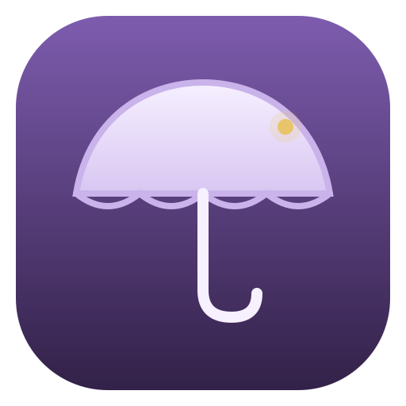

# Vivian Desktop Pet

An unofficial, non-commercial Windows 11 desktop pet built with Electron, TypeScript and React.



> **Source repository note:** this repository intentionally contains **no character artwork**. A source build has an empty pet window. The official non-commercial release, available from [Releases](https://github.com/Maixiaofanqie/ZZZ-Vivian-desktop-pet/releases), includes the full character art under the permission of 抖音@星穹列车星某.

## Features

- Transparent, always-on-top pet window with per-pixel click-through, drag-and-drop, falling and landing, hover feedback, tray controls and single-instance behavior.
- Dialogue bubbles: click lines, time-of-day greetings, optional proactive greetings, milestone Easter eggs, sitting and late-night reminders. Text fades in character by character and can be completed with a click.
- Local co-presence record: first meeting, interaction count, active days and milestones. No telemetry.
- Modules: pomodoro timer, one-off reminders, hourly chime, read-only Claude Code project panel, weather via Open-Meteo, and a schedule/todo page.
- Settings: image selection (official build), idle motion, night mode, launch at login, backup import/export and co-presence reset.

## Requirements

- Official build: Windows 11 x64. No administrator rights required. The installer is unsigned.
- Source build: Windows 11 x64, Node.js 24.x (see `.nvmrc`), npm 11+.

## Run from source

```bash
git clone https://github.com/Maixiaofanqie/ZZZ-Vivian-desktop-pet.git
cd ./ZZZ-Vivian-desktop-pet
npm ci
npm run dev
```

The source repository has no character art, so the development build has an empty pet window. This is expected.

```bash
npm run verify       # typecheck + Biome + Vitest + docs links + asset checks
npm run build        # production build to out/
npm run package:dir  # unpacked build in release/win-unpacked
npm run dist         # NSIS installer with neutral icons and no character art
```

## Licensing

- Code, original documentation and neutral icons: MIT. See [LICENSE](LICENSE).
- Noto Serif SC: SIL Open Font License 1.1. See [assets/fonts/OFL.txt](assets/fonts/OFL.txt) and [NOTICE](NOTICE).
- Character artwork: **not included in this repository**. The official non-commercial release includes it under the permission of 抖音@星穹列车星某. It is not MIT-licensed and may not be commercially adapted, extracted for redistribution, or reused in other projects. See [LICENSE-ASSETS](LICENSE-ASSETS).
- Third-party notices: [NOTICE](NOTICE).

## Privacy

Settings, co-presence data and logs stay on the local machine. The weather module sends only the selected city name/coordinates to Open-Meteo. The Claude Code module reads project metadata and session ids/names only; it does not read conversation content, prompts or source code. There is no telemetry and no automatic update check.

## Unofficial fan project

This is an unofficial fan project. _Zenless Zone Zero_ and its characters are copyright miHoYo. There is no affiliation, sales, advertising or in-app purchase. The project will remove content upon a valid request from the rights holder or the artist.

For the full Chinese documentation, start with [README.md](README.md).
